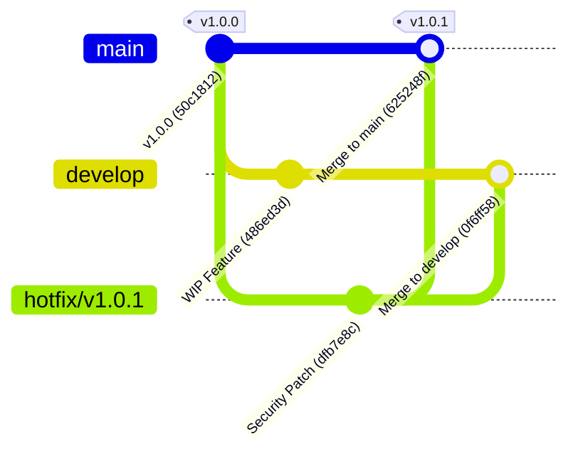

# Báo cáo: Mô phỏng quy trình Hotfix & Gitflow thực tế

## 1. Mục tiêu
- Áp dụng mô hình phân nhánh Gitflow chuẩn trong quản lý vòng đời phát triển phần mềm.
- Khởi tạo nhánh `hotfix/v1.0.1` tách trực tiếp từ `main` khi phát hiện lỗ hổng bảo mật nghiêm trọng trên môi trường Production.
- Gộp nhánh hotfix vào `main`, gắn thẻ phiên bản (tag) `v1.0.1`.
- Đồng bộ ngược bản vá từ `hotfix/v1.0.1` vào nhánh `develop` để bảo đảm tính nhất quán mã nguồn trong tương lai.

---

## 2. Quy trình thực hiện chi tiết



### Bước 1: Khởi tạo phiên bản v1.0.0 trên `main`
```bash
git init
git checkout -b main
# Commit code phiên bản đầu tiên
git add app.txt
git commit -m "release: v1.0.0 initial stable release"
git tag -a v1.0.0 -m "Release version 1.0.0"
```

---

### Bước 2: Nhánh `develop` phát triển tính năng dở dang
```bash
git checkout -b develop
# Thêm tính năng đang phát triển cho v1.1.0
git add app.txt
git commit -m "feat(develop): start implementing AI recommendation engine"
```

---

### Bước 3: Tạo nhánh `hotfix/v1.0.1` từ `main` để vá lỗi khẩn cấp
```bash
git checkout main
git checkout -b hotfix/v1.0.1
# Sửa lỗ hổng lộ thông tin dữ liệu người dùng
git add app.txt
git commit -m "fix(security): sanitize user response data in hotfix"
```

---

### Bước 4: Gộp Hotfix vào `main` và gắn tag `v1.0.1`
```bash
git checkout main
git merge --no-ff -m "Merge branch 'hotfix/v1.0.1' into main" hotfix/v1.0.1
git tag -a v1.0.1 -m "Release Hotfix version 1.0.1"
```

---

### Bước 5: Gộp ngược Hotfix vào `develop`
```bash
git checkout develop
git merge --no-ff -m "Merge branch 'hotfix/v1.0.1' into develop" hotfix/v1.0.1
# Giải quyết xung đột nếu có và hoàn tất merge
git add app.txt
git commit -m "Merge branch 'hotfix/v1.0.1' into develop"
```

---

## 3. Kết quả kiểm tra & Minh chứng

### 3.1. Danh sách các nhánh và Thẻ phiên bản (Tags)
```bash
git branch -a
git tag
```

**Output:**
```plaintext
* develop
  hotfix/v1.0.1
  main

v1.0.0
v1.0.1
```

---

### 3.2. Sơ đồ đồ thị lịch sử gộp nhánh (`git log --graph --oneline --all`)
```bash
git log --graph --oneline --all
```

**Output:**
```plaintext
*   0f6ff58 (HEAD -> develop) Merge branch 'hotfix/v1.0.1' into develop
|\  
* | 486ed3d feat(develop): start implementing AI recommendation engine
| | *   625248f (tag: v1.0.1, main) Merge branch 'hotfix/v1.0.1' into main
| |/| 
|/|/  
| * dfb7e8c (hotfix/v1.0.1) fix(security): sanitize user response data in hotfix
|/  
* 50c1812 (tag: v1.0.0) release: v1.0.0 initial stable release
```

---

## 4. Đánh giá & Kết luận
1. **Cô lập và Vá nhanh**: Nhánh `hotfix/v1.0.1` được tách trực tiếp từ commit release `v1.0.0` trên `main`, giúp deploy ngay lập tức mà không bị ảnh hưởng bởi code đang làm dở trên `develop`.
2. **Bảo đảm không trôi lỗi**: Nhờ gộp bản vá vào cả `main` và `develop`, phiên bản tương lai phát hành từ `develop` sẽ tự động kế thừa bản vá bảo mật này.
